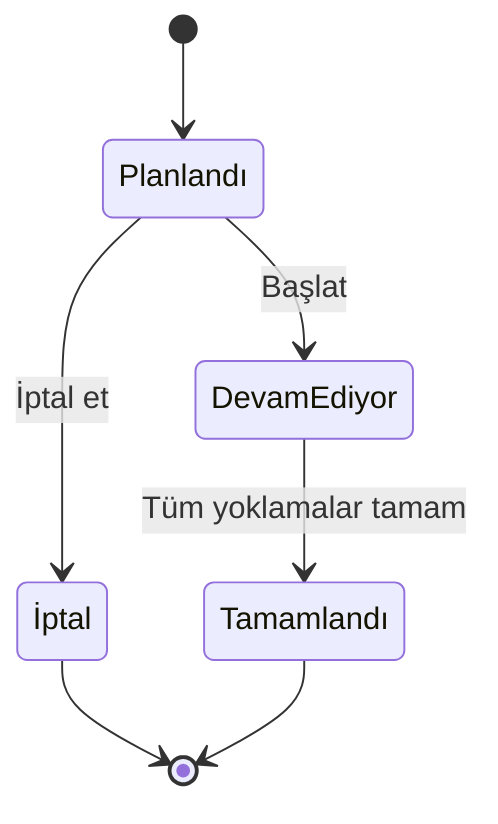

# ServisPlan

**Personel ve öğrenci servisi operasyonları için Türkçe planlama prototipi.** Araç, sürücü, hat, durak ve yolcu listelerini yönetir; kapasite ve zaman çakışmalarını kontrol ederek sefer oluşturur.

Python 3.11+ · SQLite · Vanilla JavaScript · Harici paket gerektirmez

## Çalıştırma

```bash
git clone https://github.com/Cihan-Aygun/servisplan.git
cd servisplan
python3 app.py
```

Tarayıcıda **http://127.0.0.1:8001** adresini açın. İlk çalıştırmada 4 araç, 3 sürücü, 3 hat, 10 durak, 32 yolcu ve günün tarihine ait 4 örnek sefer eklenir. Tüm kişi ve kurum kayıtları kurgusaldır. Sonraki açılışlarda veriler `data/servisplan.db` içinde korunur; gün değiştiğinde yeni örnek seferler otomatik eklenmez. Tarih filtresiyle eski seferler görülebilir.

```bash
# Farklı port
python3 app.py --port 8080
# Örnek verisiz ayrı çalışma alanı
python3 app.py --empty --db data/gerceksiz-demo.db
# Otomatik kontroller
python3 -m unittest discover -s tests -v
```

## Modüller

| Ekran | İşlevler |
|---|---|
| Operasyon özeti | Günün sefer akışı, planlanan doluluk, filo özeti, şematik hat görünümü, son hareketler |
| Seferler | Hat/araç/sürücü atama, tarih ve durum filtresi, başlatma, iptal, tamamlama |
| Hatlar ve duraklar | Hat oluşturma, varış noktası, toplam süre, dakika ofsetli durak sırası |
| Araçlar ve sürücüler | Kapasite ve hazır/bakım durumu ile araç kaydı, sürücü havuzu |
| Yolcular | Kurum bazlı yolcu kaydı, arama, durağa atama, atama değiştirme/kaldırma |
| Sefer yolcu listesi | Planlama anındaki liste, durak bilgileri, bindi/gelmedi/bekliyor yoklaması |
| Raporlar | Tamamlanan seferler, toplam biniş, hat bazlı doluluk, CSV ve işlem günlüğü |

## 3 dakikalık demo

1. **Operasyon özeti** ekranında Batı Hattı'nın 07:00 seferini başlatın.
2. **Yolcu listesi**ni açın. Sekiz yolcudan yedisine **Bindi**, birine **Gelmedi** işaretleyin.
3. Pencereyi kapatıp seferi **Tamamla** ile bitirin. Yoklama bekleyen kişi varsa tamamlama reddedilir.
4. **Raporlar** ekranında 1 tamamlanan sefer, 7 biniş, 1 gelmeyen ve %25,9 gerçekleşen doluluk görünür (7 / 27 koltuk).
5. **Sefer planla** ile Kuzey Hattı, DEMO-01 ve aynı tarihte 07:30 seçin. Var olan 07:15 seferiyle çakıştığı için kayıt reddedilir.
6. Saati 09:00 yapıp tekrar kaydedin; 14 kişilik yolcu listesi yeni sefere alınır.
7. Bir yolcunun durağını değiştirin. Mevcut seferin listesi korunur, sonraki planlamalar yeni atamayı kullanır.

## İş kuralları

- Araç kapasitesi 1–100 yolcu koltuğudur. Sürücü koltuğu kapasiteye dahil edilmemelidir.
- Bakımdaki araçlar sefere atanamaz. Her hatta seferden önce en az bir durak bulunmalıdır.
- Duraklar kalkıştan itibaren tam sayı dakika ile sıralanır. Aynı hatta eşit dakikalı durak olamaz; durak dakikası hat süresinden küçük olmalıdır.
- Yolcu tek bir durağa atanır. Gidiş ve dönüş için ayrı atama modeli bu sürümün kapsamı dışındadır.
- Sefer oluşturulurken o hattaki tüm atanmış yolcular listeye kopyalanır. Kapasite aşılırsa sefer kaydedilmez.
- Planlanan/devam eden seferlerde aynı araç, sürücü veya yolcu için örtüşen zaman aralıkları reddedilir. Bitiş anında başlayan sonraki sefer kabul edilir; hazırlık/tampon süresi modellenmez.
- Gece yarısını geçen yolculukların varış tarihi hesaplanır ve sonraki günle çakışmaları kontrol edilir.
- Araç veya sürücünün devam eden başka seferi varken yeni sefer başlatılamaz; planlanan saatleri ayrı olsa bile önce önceki sefer tamamlanmalıdır.
- Yolcu atamalarının değişmesi, mevcut sefer listelerini etkilemez.



Yoklama yalnızca devam eden seferde düzenlenir. Tamamlanan/iptal edilen seferler tekrar açılamaz. Durum geçişleri demo operatörünün manuel kaydıdır; planlanan tarihte olma zorunluluğu yoktur ve gerçek hareket zamanını ölçmez.

## Raporların anlamı

**Planlanan doluluk** = bugünün iptal edilmemiş seferlerindeki planlanan yolcu toplamı / bu seferlerin koltuk toplamı.

**Gerçekleşen doluluk** = tamamlanan seferlerde binen yolcu toplamı / tamamlanan seferlerin koltuk toplamı. Aynı yolcunun her seferi ayrı bir biniştir. CSV tüm sefer durumlarını kapsar; gerçekleşen analiz için `completed` satırlarını filtreleyin. Bu sürüm maliyet, yakıt tüketimi veya çevresel etki tahmini üretmez.

Tarih ve saatler `Europe/Istanbul` yerel planlama saatidir. Sefer zamanları yerel ISO metni, işlem günlüğü saatleri `+03:00` ofsetli ISO metni olarak saklanır. Çoklu zaman dilimi desteklenmez.

## Teknik yapı

```text
app.py                   HTTP sunucusu, iş kuralları ve SQLite
static/index.html        Türkçe uygulama kabuğu ve formlar
static/style.css         Mobil uyumlu operasyon paneli
static/app.js            Filtreler, yönetim ekranları, yoklama
tests/test_app.py        23 iş kuralı ve HTTP testi
docs/API.md              İstek örnekleri ve uç noktalar
docs/ARCHITECTURE.md     Veri modeli ve tutarlılık
docs/ROADMAP.md          Çok kullanıcılı sürüm planı
.github/workflows/       Python 3.11–3.14 test matrisi
```

Çakışma kontrolü ve yazma işlemleri SQLite `BEGIN IMMEDIATE` içinde yapılır. Aynı anda gönderilen planlama istekleri kapasite/atama kontrollerini aşamaz. Veritabanı okumaları tek tutarlı görüntüden yapılır. SQL değerleri parametrelidir; metinler arayüzde HTML olarak kaçışlanır. CSV'de formül başlatabilecek metinler etkisizleştirilir. Tarayıcıdan gelen yazma isteklerinde kaynak adresi ve JSON içerik türü kontrol edilir.

## Kapsam

Bu sürüm tek kullanıcılı **yerel prototiptir**. Sunucu `127.0.0.1` üzerinde dinler. Üretim dağıtımı, kimlik doğrulama, firma/rol yetkilendirmesi, gerçek GPS, harita sağlayıcısı, otomatik rota optimizasyonu, bildirimler veya öğrenciye ilişkin veli/teslim yetkisi süreçleri içermez. Mevcut kayıtları genel olarak düzenleme/silme ve sefer içi yolcu transferi henüz desteklenmez. Çok kullanıcılı servis için [yol haritasındaki](docs/ROADMAP.md) gereksinimler uygulanmalıdır.

Başlangıç kayıtları sentetiktir. Harita yerine gösterilen hat çizimi bir durak şemasıdır. Demo veritabanları Git'e eklenmez.

## Lisans

[MIT](LICENSE)
