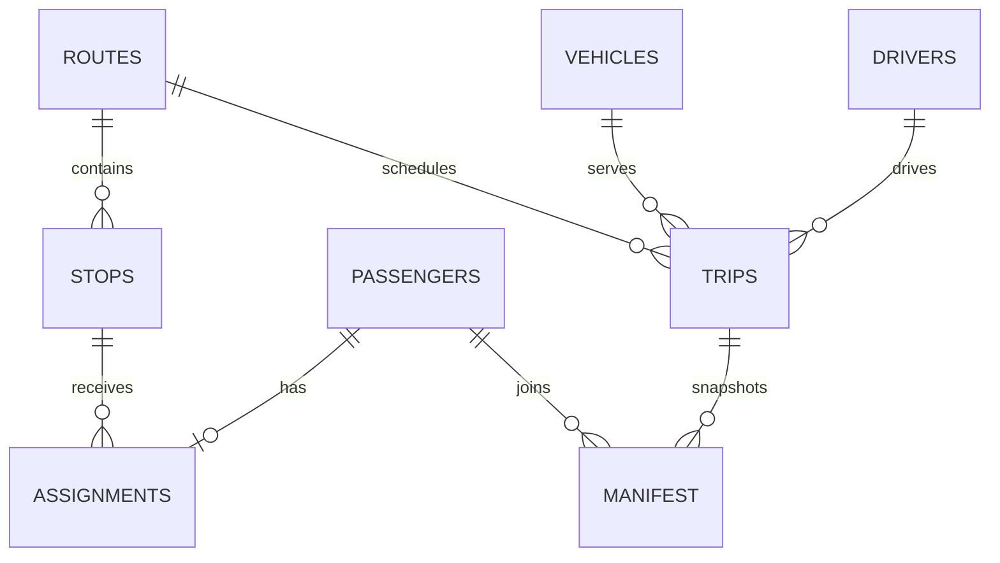

# Mimari ve veri tutarlılığı

## Veri modeli

`manifest`, yolcu adı/kurumu ile durak adı/dakikasının sefer oluşturulduğu andaki kopyasını saklar. Yolcu durak değiştirirse eski listeler aynı kalır. Araç kapasitesi ve hat süresi için düzenleme API'si bulunmadığından bu değerlerin tarihsel değişimi mevcut sürümde oluşmaz. Düzenleme eklendiğinde kapasite, hat adı ve varış noktası da sefer içinde sürümlenmelidir.

## Sefer oluşturma işlemi

1. SQLite yazma kilidi `BEGIN IMMEDIATE` ile alınır.
2. Hat, araç, sürücü ve durakların varlığı doğrulanır.
3. Araç durumuna ve hat yolcu sayısına göre kapasite kontrol edilir.
4. `[departure, arrival)` aralığı hesaplanır.
5. Aktif planlardaki kaynak ve yolcu çakışmaları sorgulanır.
6. Sefer, manifesto ve hareket kaydı birlikte yazılır.
7. Hata durumunda tamamı geri alınır; başarıda birlikte kaydedilir.

`existing.departure < new.arrival AND existing.arrival > new.departure` koşulu gece yarısı dahil örtüşen aralıkları bulur. Arka arkaya seferlere izin verir. İptal edilen/tamamlanan seferler gelecek planlamayı engellemez. Başlatma sırasında ayrıca gerçekten `running` durumunda bulunan araç/sürücü kontrol edilir.

## Okuma ve istemci

Dashboard API'si tüm koleksiyonları tek SQLite okuma işlemi içinde alır. İstemci değişiklik sonrası tüm görünümü yeniler; sürekli canlı güncelleme yoktur. Ayrı açık tarayıcı sekmesindeki değişiklikler için sayfa yenilenmelidir. Küçük yerel veri seti hedeflenmiştir; sayfalama ve büyük veri performansı sonraki sürüme bırakılmıştır.

## Sınırlar

Python `http.server` geliştirme amaçlıdır. Kimlik doğrulama, rol, ağ erişim kontrolü ve üretim altyapısının yerini almaz. İşlem günlüğü demo operatör hareketlerini gösterir; kriptografik veya kurumsal denetim kanıtı değildir. Sefer durumları manuel olarak işaretlenir ve gerçek hareket/bitiş zamanını ölçmez.
